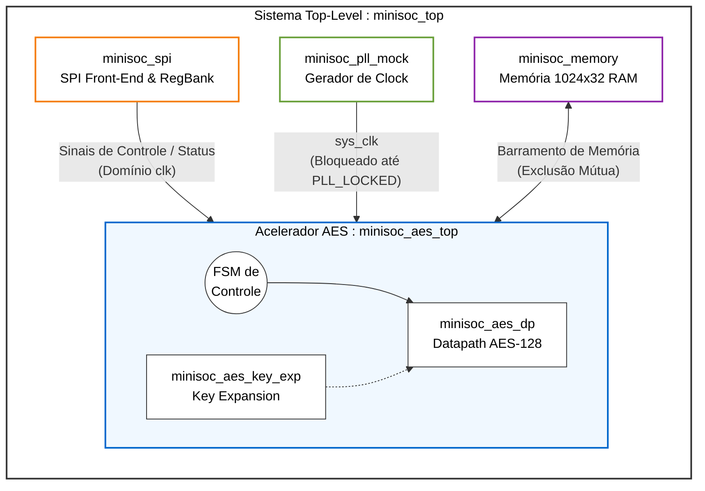
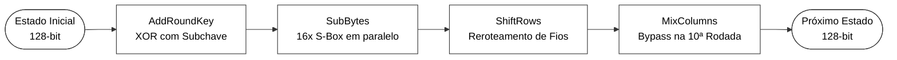
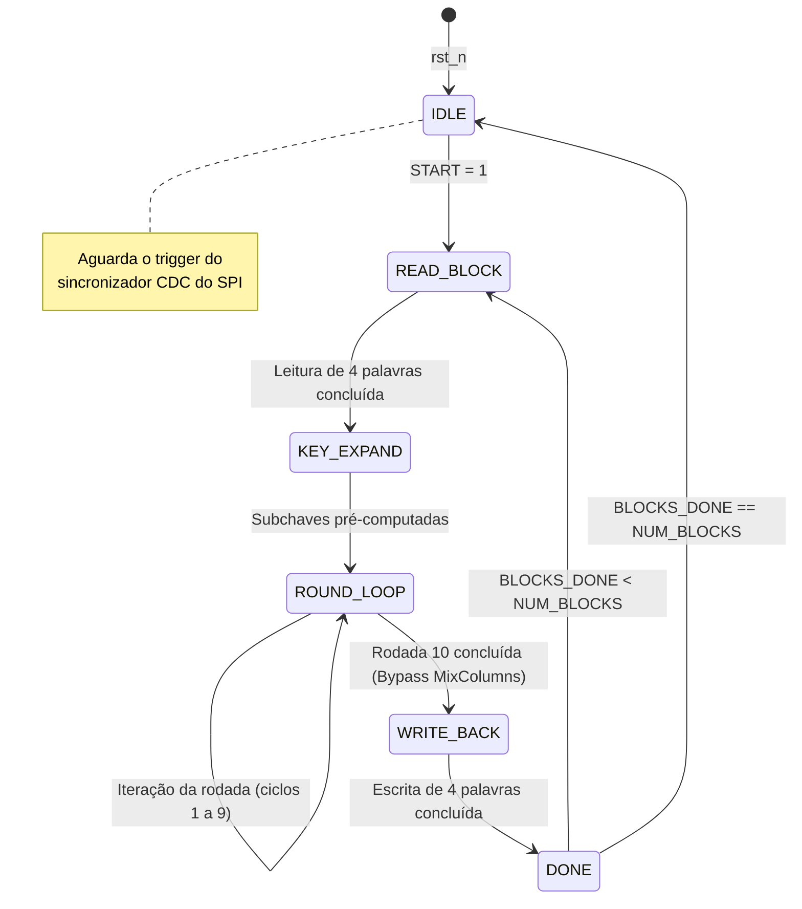

# Documento de Microarquitetura — MiniSoC AES (v1.0)

**Autor:** Matheus Cunha
**Data:** 06/11/2026  
**Especificação de Referência:** Block Guide MiniSoC AES v1.0.0  

## 1. Visão Geral da Arquitetura
O MiniSoC AES é um IP acelerador criptográfico de 128 bits parametrizável por SPI, com acesso a memória compartilhada de $1024 \times 32$ bits.

### 1.1 Diagrama de Blocos do Sistema (Top-Level)

## 2. Decisões Arquiteturais do Datapath AES (`minisoc_aes_dp`)

1. **Topologia Iterativa (1 rodada por ciclo):**
   - **Vazão:** 10 a 11 ciclos de clock por bloco de 128 bits.
   - **Paralelismo:** 16 S-boxes instanciadas em paralelo no módulo `SubBytes` para otimizar tempo de execução.
   - **Compromisso Área x Desempenho:** Evita o consumo excessivo de área de uma arquitetura totalmente *pipelined* (160 S-boxes), mantendo vazão significativamente superior à abordagem 1-byte serial (160 ciclos/bloco).

2. **Expansão de Chave (`minisoc_aes_key_exp`):**
   - As 11 *round keys* (144 bytes) são pré-computadas na inicialização e armazenadas em registradores internos durante a fase de setup, eliminando a latência de cálculo *on-the-fly* nas operações multiblocos.

### 2.1 Fluxo Combinacional de Cifragem (Cipher)

### 2.2 Fluxo Combinacional de Decriptação (Inverse Cipher)

Quando configurado para decriptação (ex.: ECB/CBC Decrypt), o *datapath* é reconfigurado via multiplexadores para utilizar os módulos inversos. As chaves pré-computadas são consumidas na ordem reversa ($K_{10} \to K_0$).

```mermaid
flowchart LR
    IN([Estado Inicial<br/>128-bit]) --> IARK[AddRoundKey<br/>XOR com K10]
    IARK --> ISR[InvShiftRows<br/>Reordenamento Inverso]
    ISR --> ISB[InvSubBytes<br/>16x InvS-Box]
    ISB --> ARK2[AddRoundKey<br/>XOR com Subchave]
    ARK2 --> IMC[InvMixColumns<br/>Bypass na 10ª Rodada]
    IMC --> OUT([Próximo Estado<br/>128-bit])
    
    style IN fill:#ffffff,stroke:#333,color:#000
    style IARK fill:#ffffff,stroke:#333,color:#000
    style ISR fill:#ffffff,stroke:#333,color:#000
    style ISB fill:#ffffff,stroke:#333,color:#000
    style ARK2 fill:#ffffff,stroke:#333,color:#000
    style IMC fill:#ffffff,stroke:#333,color:#000
    style OUT fill:#ffffff,stroke:#333,color:#000
```

## 3. Máquina de Estados (FSM) do `minisoc_aes_top`

A FSM opera no domínio `sys_clk` e é estruturada nos seguintes estados principais:

- **IDLE:** Aguarda o pulso de comando `START` gravado via SPI em `AES_CONTROL[0]`.
- **READ_BLOCK:** Lê 4 palavras de 32 bits da memória compartilhada (`base + 4*block_idx`).
- **KEY_EXPAND:** Expande a chave original de 128 bits armazenada nos registradores `KEY0..KEY3`.
- **ROUND_LOOP:** Executa 10 rodadas iterativas controladas pelo contador `round_idx`. O comportamento do datapath depende do registrador de configuração `MODE` (Cifragem ou Decifração):
  - **Em Cifragem:** O dado atravessa `SubBytes` $\to$ `ShiftRows` $\to$ `MixColumns` $\to$ `AddRoundKey` (chaves $K_1 \to K_{10}$). Na **10ª rodada**, a FSM ativa o *bypass* do `MixColumns`.
  - **Em Decriptação:** O dado atravessa `InvShiftRows` $\to$ `InvSubBytes` $\to$ `AddRoundKey` $\to$ `InvMixColumns` (chaves $K_9 \to K_0$). Na **10ª rodada**, a FSM ativa o *bypass* do `InvMixColumns`.
- **WRITE_BACK:** Escreve as 4 palavras resultantes *in-place* no mesmo endereço da memória.
- **DONE:** Incrementa `BLOCKS_DONE`. Se `BLOCKS_DONE == NUM_BLOCKS`, eleva `DONE=1` e retorna a `IDLE`.

## 4. Estratégia de Clock Domain Crossing (CDC)

1. **Front-End SPI (`spi_sclk`) $\to$ Clock Always-On (`clk`):**
   - Os frames de 40 bits recebidos no domínio serial de `spi_sclk` são transferidos para o domínio `clk` por um sincronizador de pulso/toggle.

2. **Handshake de Controle `clk` $\to$ `sys_clk`:**
   - O sinal de inicio `START` passa por um sincronizador de borda de 2 estágios antes de disparar a FSM do AES.

## 5. Sequência de Reset e Travamento do PLL

1. O reset global assíncrono `rst_n` reinicializa os registradores de controle no domínio `clk`.
2. O domínio `sys_clk` mantêm-se retido em reset interno até que `SYSTEM_CONTROL.PLL_ENABLE` seja ativado e o sinal `SYSTEM_STATUS.PLL_LOCKED` atinja nível alto (`1`).
